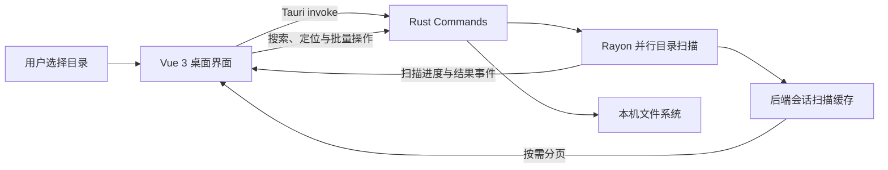

<div align="center">
  
  <h1>fsize</h1>
  <p>本地优先的跨平台目录空间分析工具</p>

  <p>
    
    <a href="https://github.com/ligson/fsize/releases/latest"></a>
  </p>

  <p>
    
    
    
    
    
    
  </p>
</div>

`fsize` 是一个运行在本机的桌面目录空间分析器。选择目录后，它会递归统计文件与各级目录的大小，以树形视图和搜索结果帮助你找出占用空间较大的内容；文件数据留在本地，不需要上传到云端服务。

## 项目状态

当前版本为 **0.2.3**。目录扫描、文件搜索、系统文件管理器定位、批量删除与移动等核心流程均可使用。项目仍在持续完善中，欢迎通过 Issue 反馈问题和改进建议。

## 核心能力

- **目录空间统计**：递归计算文件大小和目录累计大小，条目按大小降序排列。
- **并行扫描**：Rust 后端使用可复用的 Rayon 线程池并行读取文件元数据和遍历较大的目录，最多使用 4 个工作线程，为桌面界面保留处理资源。
- **按需浏览**：扫描结果保留在 Rust 后端；展开目录时按页加载子项，超大目录不会一次性传入或渲染全部条目。
- **扫描进度**：扫描期间显示当前处理目录、已处理条目数和持续更新的耗时；进度通知经过节流，避免大量文件时频繁刷新界面。
- **文件搜索**：在后端扫描缓存中按文件名或完整路径搜索，只把匹配结果传给界面，并查看位置和大小。
- **快速定位**：在 Windows Explorer、macOS Finder 或 Linux 文件管理器中显示对应路径。
- **批量管理**：从目录树或搜索结果选择项目，批量删除或移动；移动不会覆盖目标目录中的同名项目。
- **部分结果可见**：无权读取的条目仍显示在列表中；无法完整统计的目录会标记为部分结果，实际操作时再报告权限错误。
- **桌面主题**：预置两种亮色和两种暗色主题，选择保存在本机；滚动条颜色随主题变化。

扫描会跳过符号链接，不跟随链接遍历目标。文件大小按文件逻辑长度统计，不等于文件系统实际分配空间。扫描缓存只在当前应用会话中保留，刷新或重新扫描后重建；搜索结果最多显示 1000 条。删除目录会递归删除其全部内容，执行前会要求确认。

## 架构



## 技术栈

| 层级 | 技术 | 用途 |
| --- | --- | --- |
| 桌面容器 | Tauri 2 | 原生窗口、插件与系统集成 |
| 前端 | Vue 3、TypeScript、Vite | 桌面工作区和交互逻辑 |
| UI | Naive UI | 控件、树形视图、对话框与主题 |
| 后端 | Rust | 文件遍历、大小统计和文件操作 |
| 并行处理 | Rayon | 大型目录树的并行扫描，最多 4 个工作线程 |
| 前后端通信 | Tauri Commands、Events | 调用系统操作并接收异步扫描结果 |

## 下载

从 [GitHub Releases](https://github.com/ligson/fsize/releases/latest) 下载适合平台的安装包。当前 Release 提供 Windows x64 安装程序、Linux x64 的 AppImage/deb/rpm，以及 macOS ARM64 安装包。macOS 构建暂未配置 Apple Developer 签名与公证。

## 快速开始

### 环境要求

- Node.js 与 pnpm
- Rust stable 工具链
- Tauri 2 在目标操作系统所需的系统依赖，详见 [Tauri 前置条件](https://v2.tauri.app/start/prerequisites/)

### 启动桌面开发版

```bash
git clone https://github.com/ligson/fsize.git
cd fsize
pnpm install
pnpm tauri dev
```

### 构建与检查

```bash
pnpm install --frozen-lockfile
pnpm build
pnpm tauri build
```

`pnpm build` 执行 TypeScript 类型检查和前端生产构建。`pnpm tauri build` 构建当前主机平台的桌面安装包。发版标签和 GitHub Actions 流程见[开发文档](docs/development.md#github-自动发布)。

## 项目结构

```text
fsize/
├── .github/workflows/       GitHub Actions 发布工作流
├── docs/                    架构与开发文档
├── public/app-icon.svg      应用图标源文件
├── src/                     Vue 前端
│   ├── App.vue              主窗口布局与主题设置
│   ├── FileTree.vue         文件树、搜索和批量操作
│   └── assets/app.css       主题与界面样式
├── src-tauri/               Tauri 配置与 Rust 后端
│   └── src/commands/        扫描、定位、删除与移动命令
├── AGENTS.md                仓库协作约定
├── CHANGELOG.md             版本变更记录
└── README.md
```

## 文档

- [工程架构与功能上下文](docs/architecture.md)
- [开发、构建与发版说明](docs/development.md)
- [版本更新日志](CHANGELOG.md)
- [仓库协作约定](AGENTS.md)

## 参与贡献

欢迎提交 Issue 和 Pull Request。提交前请阅读 [AGENTS.md](AGENTS.md)，涉及功能或架构的变动请同步更新相应文档；代码或用户可见行为的变化应记录在 `CHANGELOG.md`。
